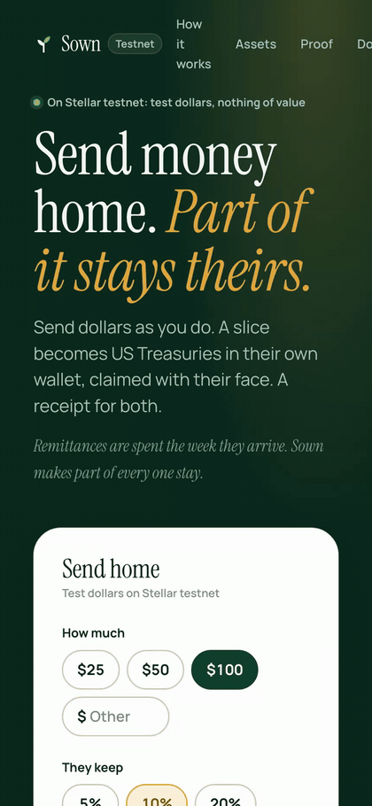
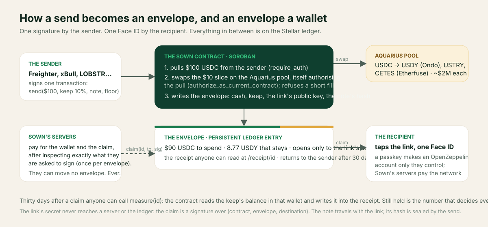

# Sown

**Send money home. Part of it stays theirs.** Live on Stellar mainnet at [sown.world](https://sown.world).

A person abroad sends dollars home on Stellar and answers one question, *keep how much?* In the
same transaction, that slice becomes US Treasuries (Ondo USDY) or Mexican CETES (Etherfuse),
bought on Aquarius inside a Soroban contract. The person at home taps a link; one Face ID makes
them a wallet, and both parts are theirs: dollars to spend, Treasuries that stay. Every send
and every claim is a receipt anyone can open, read from the ledger.

<p align="center"></p>

| | |
| --- | --- |
| **Mainnet contract** | [`CDQUJPAEWFFPS6ZBVF7SIRIVSKZDVMDZB4NFD3IAFS6D67N2JHMUHRFE`](https://stellar.expert/explorer/public/contract/CDQUJPAEWFFPS6ZBVF7SIRIVSKZDVMDZB4NFD3IAFS6D67N2JHMUHRFE), deployed 10 Oct 2026 with US Treasuries (Ondo USDY), US Treasury notes (Etherfuse USTRY) and Mexican CETES registered ([`deployments/mainnet.json`](deployments/mainnet.json)) |
| **Testnet contract** | [`CCKMIXT4SERT4OFTIGCRLPAFPUED4WW6J7SKCZ46QBOLHBCV3CTAHQSB`](https://stellar.expert/explorer/testnet/contract/CCKMIXT4SERT4OFTIGCRLPAFPUED4WW6J7SKCZ46QBOLHBCV3CTAHQSB) |
| **Its code** | sha256 `7d047dcedfe73b692e2def44c1ab16634b0dfe4325c0e40ce9bdefb189c9e167`, the bytes of [`artifacts/sown.wasm`](artifacts/sown.wasm), dumped back from the ledger and compared. No upgrade function exists |
| **Run on mainnet** | [`deployments/mainnet-smoke.json`](deployments/mainnet-smoke.json): $1 sent keeping 10% as real USDY, claimed into a wallet made with one passkey, both parts moved back; the receipt at [sown.world/receipt/0](https://sown.world/receipt/0) |
| **Every path, run on testnet** | [`deployments/testnet-battery.json`](deployments/testnet-battery.json) and [`deployments/testnet-smoke.json`](deployments/testnet-smoke.json): every transaction hash |
| **Unaudited** | the contract and the wallet kit. Not offered to US persons, by the issuers' terms |

## For the judges: two minutes

1. **Open [sown.world](https://sown.world) on your phone.** The card quotes the real Aquarius pool: $100 keeping 10% becomes about 8.8 USDY, Ondo's US Treasuries. Nothing on any page is sampled or simulated.
2. **Claim an envelope with your face.** The submission's "other links" carry claim links to small real envelopes on mainnet. Tap one, tap "Claim with Face ID": a wallet only you control is made on the spot, Sown's servers pay the network, and your wallet page shows the dollars and the Treasuries in your own money. On a laptop without Touch ID the page shows a QR to open it on your phone.
3. **Read a receipt from the ledger**: [sown.world/receipt/0](https://sown.world/receipt/0) is the mainnet smoke, a dollar into real USDY and back. Every figure is read from the contract, and the proof page ([sown.world/proof](https://sown.world/proof)) shows the code's hash matching this repository.
4. **Send one yourself** with Freighter, xBull, LOBSTR or Hana holding USDC on Stellar: one approval, and the receipt prints with the link and a QR.

<p align="center"></p>

### What Stellar gives it

| Stellar feature | Where it is used |
| --- | --- |
| Soroban contract with a cross-contract Aquarius swap, authorised by the contract itself (`authorize_as_current_contract`) | `send`: the slice is bought at the pool's price in the same transaction, or nothing happens |
| Stellar Asset Contracts for USDC, USDY, USTRY, CETES | real issued assets, held by the contract and by passkey wallets with nothing to set up first |
| Passkey smart accounts (OpenZeppelin's account contracts through the Smart Account Kit) | the recipient's wallet, made from one Face ID, controlled by nobody else |
| Fees paid for the recipient, and the XLM a classic wallet must set aside | Sown's servers pay for the wallet, the claim, and a classic wallet's lines, after inspecting the exact shape |
| Persistent storage with TTL | the envelope is the receipt, in the ledger, not only in a database |
| `ed25519_verify` in the contract | a claim is a signature by the link's key over (contract, envelope, destination); the secret never travels |
| Issuer flags read from Horizon | what Ondo and Etherfuse can do, on every row, from the chain |
| Aquarius liquidity in government debt issued on Stellar | about $2M of USDC depth for each keep asset on mainnet |

## Run it

```bash
npm install
npm run setup:testnet   # .env.local with a new testnet account for Sown's servers, funded by Friendbot
npm run dev             # http://localhost:3100, on the testnet contract above
```

The test wallet in the wallet list (testnet only) funds itself from Friendbot and Aquarius, so a
send can be tried without installing anything. Freighter, xBull, LOBSTR, Hana and Albedo work
too. Claiming with Face ID needs a device with a passkey; any Stellar wallet can claim as well.

## What happens

1. **The send** — one Soroban transaction the sender signs: USDC in; the keep slice swapped on
   Aquarius's USDC pool by the contract itself (`authorize_as_current_contract`), with a floor
   the sender saw before signing; both parts placed in an **envelope**.
2. **The envelope** — an entry in the contract holding the cash and the keep for whoever holds
   the link's key, with a return date. The link carries an ed25519 key in its fragment; the
   contract holds only its public half, so the secret never reaches a server or the ledger. A
   name and a note can ride in the same fragment: the send seals their sha256 into the envelope,
   and the claim page shows them only if the ledger's seal matches (`src/lib/envelope/note.ts`).
3. **The claim** — the recipient signs which wallet receives it (`ed25519_verify` over the
   contract, the envelope and the destination, so a claim cannot be redirected). With Face ID,
   the Smart Account Kit makes an OpenZeppelin smart account bound to their passkey, and Sown's
   servers pay the network for the wallet and the claim, after checking the exact shape of what
   they are asked to pay for (`src/lib/relay/inspect.ts`, tested against recorded transactions
   and every near-miss).
4. **The receipt** — `/receipt/<id>` reads the envelope and the transactions from the chain,
   never from a database. Thirty days after a claim, anyone can call `measure(id)` and the
   contract writes how much of the keep is still held into the envelope.

`/proof` prints the contract, its code hash against the repository's, the admin's one power
(adding or disabling a keep asset for future sends), what Sown's servers hold and have paid,
the pools, and every envelope. `/assets` reads each issuer's powers from its account on every
request; on 8 October all three issuers could claw back what they issued, and each row says so.

## Check it

```bash
npm run lint && npm run typecheck && npm run test   # the offline suite
npm run contract:test                               # the contract's tests, with a mock pool
npm run battery:testnet                             # every path on testnet, written to deployments/
npm run smoke:mainnet -- --network testnet          # a dollar sent, claimed with a software passkey, moved back
```

## Deploy to mainnet

Written and proven on testnet; never run on mainnet by the agent that wrote it. In order:

```bash
npm run preflight                                   # what it costs, simulated against mainnet
SOWN_ADMIN_SECRET=S… SOWN_MAINNET=yes npm run contract:deploy:mainnet
npm run smoke:mainnet -- --dry                      # read only: code, assets, balances, the send simulated
SOWN_MAINNET=yes SOWN_SPONSOR_SECRET=S… SOWN_SMOKE_SENDER_SECRET=S… npm run smoke:mainnet
npm run smoke:mainnet -- --record <id>              # after the filmed send and claim
```

The contract never extends its own life (a user would pay the code's rent): whoever runs Sown
does, every few months, with `npm run keep-alive -- --network mainnet`.

## Where things are

| Path | What |
| --- | --- |
| `contracts/sown` | the Soroban contract and its tests |
| `src/lib/relay` | what Sown's servers agree to pay for, and the checks before they sign |
| `src/lib/envelope` | the envelope, the claim signature, the receipt read from the chain |
| `src/lib/assets` | the catalogue, the issuers' words, their powers read from the ledger |
| `scripts` | deploy, battery, smoke, preflight, keep-alive, measure |
| `CLAUDE.md` | the specification, and every place the code differs from it |
| `docs/RESEARCH.md` | every number and every Stellar fact, with its source |

MIT licence.
